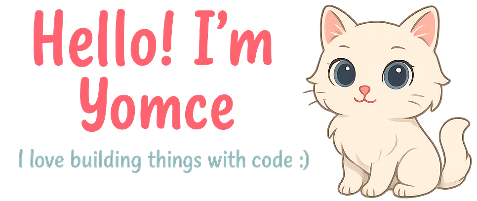

<!-- 

  

 -->

## 👋 Hi there!

## 👩🏻‍💻 About Me
- 안녕하세요! 현재 알고리즘과 개발을 공부 중인 코린이입니다.
- 🌳 **크래프톤 정글**에서 몰입하며 성장 중입니다.
- 🧠 **자료구조와 컴퓨터 시스템**에 큰 관심이 있어요.
- 💬 언제든 연락주세요 👉 
  

---

## ⚒️ Tech Stack

### 💻 Programming Languages

  
  
  
  

### 🌐 Front-End

  
  
  
  
  

### 🔙 Back-End

  
  
  

### 🗄️ Database

  
  
  
  

### ☁️ DevOps & Deployment

  
  
  
  
  
  

### 🛠️ Development Tools

  
  

### 💬 Communication

  
  
  

---

## 📊 GitHub Stats

|  |  |
| ------------- | ------------- |

---

## 📌 Top Repositories

---

## 📫 Contact

---

<!-- Optional: Velog stats -->
## ✍️ Velog

